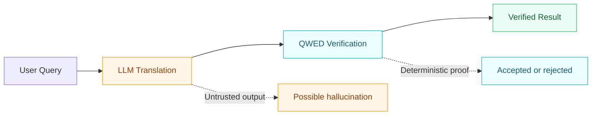

<Note>
**QWED v9.1.0 is the current release.** `CodeVerifier` now admits Python code only when the modules, builtins and special attributes it uses are listed, and each LLM provider runs the model you configure. Some code that earlier releases admitted is now refused, so read the [9.1.0](/changelog#v9-1-0-—-allowlist-admission-for-python-code) and [9.0.0](/changelog#v9-0-0-—-eleven-advisories-and-models-you-configure) upgrade steps before you upgrade.
</Note>

## What is QWED?

QWED (Query With Evidence & Determinism) is a trust boundary for AI systems:

- LLMs can translate user intent into structured claims.
- QWED verifies those claims with deterministic engines before execution or response.
- You get proof-backed outcomes instead of probability-only confidence.

QWED is designed for LLM verification, AI agent security, verified tool calls, prompt injection defense, and deterministic transaction verification in high-stakes workflows.

> **"Do not trust generated output. Verify it."**



## Explore common verification problems

<CardGroup cols={2}>
  <Card title="LLM verification" icon="badge-check" href="/advanced/llm-verification">
    Learn how formal verification for LLMs differs from prompting, RAG, and output formatting.
  </Card>
  <Card title="AI agent security" icon="shield-halved" href="/advanced/agent-verification">
    Add pre-execution checks, policy enforcement, and budget controls for agent actions.
  </Card>
  <Card title="Prompt injection defense" icon="lock" href="/advanced/security-hardening">
    Harden your stack against prompt injection, exfiltration, and unsafe execution paths.
  </Card>
  <Card title="QWED MCP" icon="plug" href="/mcp/overview">
    Give MCP clients access to QWED's deterministic verification libraries.
  </Card>
</CardGroup>

## When to use QWED first

<CardGroup cols={2}>
  <Card title="Math and logic" icon="square-root-variable">
    Verify equations, constraints, and logical claims before they reach users.
  </Card>
  <Card title="Code and SQL" icon="code">
    Catch unsafe patterns, injection risks, and structural errors before execution.
  </Card>
  <Card title="Agent tool calls" icon="toolbox">
    Inspect actions and payloads before external systems are touched.
  </Card>
  <Card title="High-stakes workflows" icon="shield-halved">
    Add deterministic checkpoints for finance, legal, tax, and regulated systems.
  </Card>
</CardGroup>

## Quick start (5 minutes)

```bash
pip install qwed==9.1.0
```

The examples below use the `qwed` CLI that this installs. The `qwedai/qwed-verification:9.1.0` Docker image runs the API server instead; see [Self-hosting](/advanced/self-hosting#docker).

```bash
# Run every engine on known cases (no LLM needed)
qwed test
# Math:
#   [ok] 2+2=4                  -> VERIFIED | ADMIT
#   [ok] 2+2=5                  -> VERIFIED (false) | DENY
#   ...

# Verify logic constraints
qwed verify-logic "(AND (GT x 5) (LT y 10))"
# -> SAT: {x=6, y=9}
```

<Steps>
  <Step title="Install and configure">
    Follow [Installation](/getting-started/installation) and set your provider with [LLM configuration](/getting-started/llm-configuration).
  </Step>
  <Step title="Run first verification">
    Use [Quick start](/getting-started/quickstart) to validate math, logic, code, and SQL.
  </Step>
  <Step title="Integrate into production flow">
    Use [Integration getting started](/integration/getting-started) and [Production deployment](/integration/production).
  </Step>
</Steps>

## Verification engines at a glance

<CardGroup cols={3}>
  <Card title="Math" icon="square-root-variable" href="/engines/math">
    SymPy-based symbolic verification.
  </Card>
  <Card title="Logic" icon="microchip" href="/engines/logic">
    Z3 SAT/SMT verification with models.
  </Card>
  <Card title="Code" icon="code" href="/engines/code">
    AST and symbolic checks for risky behavior.
  </Card>
  <Card title="SQL" icon="database" href="/engines/sql">
    Parser-backed SQL safety and validation.
  </Card>
  <Card title="Schema" icon="brackets-curly" href="/engines/schema">
    Type and shape validation for structured outputs.
  </Card>
  <Card title="Taint" icon="shield-halved" href="/engines/taint">
    Data-flow tracking for untrusted inputs.
  </Card>
</CardGroup>

<Card title="See all engines" icon="book" href="/engines/overview">
  Explore core, analysis, and specialized engines.
</Card>

## What's new in v9

<AccordionGroup>
  <Accordion title="Allowlist admission for Python code" icon="shield-check" defaultOpen>
    From v9.1.0, `CodeVerifier` admits Python code only when every module, module name, builtin and special attribute it uses is on a list, and the code reads no attribute by a name made at run time. Each refusal names the module, builtin or attribute. A caller can name modules its own runtime confines with `trusted_modules`, as the code-execution sandbox does for `numpy` and `pandas`; the module checks then skip those modules, so they need that confinement. [Read the 9.1.0 notes →](/changelog#v9-1-0-—-allowlist-admission-for-python-code)
  </Accordion>
  <Accordion title="Before you upgrade" icon="triangle-exclamation">
    From v9.0.0, QWED names no model of its own: set your provider's model variable, such as `OPENAI_MODEL` or `ANTHROPIC_MODEL`, and pass `model=` to `QWEDLocal`, `verify()` and `qwed_sdk.integrations.langchain.QWEDTool`. `/verify/math` runs in worker processes with a time limit, the CSV exports change their columns, and the Go module path moves to `/v9`. Upgrade every server process together. [Read the upgrade steps →](/changelog#v9-0-0-—-eleven-advisories-and-models-you-configure)
  </Accordion>
</AccordionGroup>

## Recommended learning path

1. [Core concepts](/getting-started/concepts)
2. [Architecture overview](/architecture)
3. [SDKs overview](/sdks/overview)
4. [API overview](/api/overview)
5. [Integration guide](/integration/getting-started)