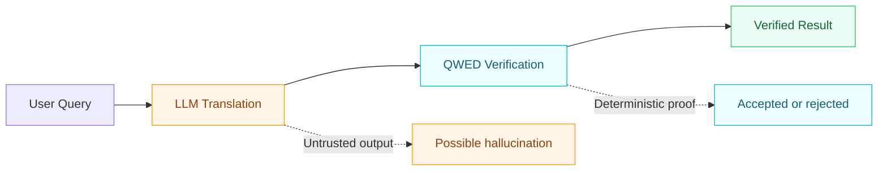

<Note>
**QWED v10.0.0 is the current release.** Routes stop reporting `VERIFIED`, or admitting a result, on evidence that doesn't prove the claim, and the `claude_opus` provider is removed. Some results that 9.1.0 reported as `VERIFIED` or admitted are now `UNVERIFIABLE` or `BLOCKED`, so read the [10.0.0 upgrade steps](/changelog#v10-0-0-—-verdicts-that-prove-the-claim-and-claude_opus-removed) before you upgrade.
</Note>

## What is QWED?

QWED (Query With Evidence & Determinism) is a trust boundary for AI systems:

- LLMs can translate user intent into structured claims.
- QWED verifies those claims with deterministic engines before execution or response.
- You get proof-backed outcomes instead of probability-only confidence.

QWED is designed for LLM verification, AI agent security, verified tool calls, prompt injection defense, and deterministic transaction verification in high-stakes workflows.

> **"Do not trust generated output. Verify it."**



## Explore common verification problems

<CardGroup cols={2}>
  <Card title="LLM verification" icon="badge-check" href="/advanced/llm-verification">
    Learn how formal verification for LLMs differs from prompting, RAG, and output formatting.
  </Card>
  <Card title="AI agent security" icon="shield-halved" href="/advanced/agent-verification">
    Add pre-execution checks, policy enforcement, and budget controls for agent actions.
  </Card>
  <Card title="Prompt injection defense" icon="lock" href="/advanced/security-hardening">
    Harden your stack against prompt injection, exfiltration, and unsafe execution paths.
  </Card>
  <Card title="QWED MCP" icon="plug" href="/mcp/overview">
    Give MCP clients access to QWED's deterministic verification libraries.
  </Card>
</CardGroup>

## When to use QWED first

<CardGroup cols={2}>
  <Card title="Math and logic" icon="square-root-variable">
    Verify equations, constraints, and logical claims before they reach users.
  </Card>
  <Card title="Code and SQL" icon="code">
    Catch unsafe patterns, injection risks, and structural errors before execution.
  </Card>
  <Card title="Agent tool calls" icon="toolbox">
    Inspect actions and payloads before external systems are touched.
  </Card>
  <Card title="High-stakes workflows" icon="shield-halved">
    Add deterministic checkpoints for finance, legal, tax, and regulated systems.
  </Card>
</CardGroup>

## Quick start (5 minutes)

```bash
pip install qwed==10.0.0
```

The examples below use the `qwed` CLI that this installs. The `qwedai/qwed-verification:10.0.0` Docker image runs the API server instead; see [Self-hosting](/advanced/self-hosting#docker).

```bash
# Run every engine on known cases (no LLM needed)
qwed test
# Math:
#   [ok] 2+2=4                  -> VERIFIED | ADMIT
#   [ok] 2+2=5                  -> VERIFIED (false) | DENY
#   ...

# Verify logic constraints
qwed verify-logic "(AND (GT x 5) (LT y 10))"
# -> SAT: {x=6, y=9}
```

<Steps>
  <Step title="Install and configure">
    Follow [Installation](/getting-started/installation) and set your provider with [LLM configuration](/getting-started/llm-configuration).
  </Step>
  <Step title="Run first verification">
    Use [Quick start](/getting-started/quickstart) to validate math, logic, code, and SQL.
  </Step>
  <Step title="Integrate into production flow">
    Use [Integration getting started](/integration/getting-started) and [Production deployment](/integration/production).
  </Step>
</Steps>

## Verification engines at a glance

<CardGroup cols={3}>
  <Card title="Math" icon="square-root-variable" href="/engines/math">
    SymPy-based symbolic verification.
  </Card>
  <Card title="Logic" icon="microchip" href="/engines/logic">
    Z3 SAT/SMT verification with models.
  </Card>
  <Card title="Code" icon="code" href="/engines/code">
    AST and symbolic checks for risky behavior.
  </Card>
  <Card title="SQL" icon="database" href="/engines/sql">
    Parser-backed SQL safety and validation.
  </Card>
  <Card title="Schema" icon="brackets-curly" href="/engines/schema">
    Type and shape validation for structured outputs.
  </Card>
  <Card title="Taint" icon="shield-halved" href="/engines/taint">
    Data-flow tracking for untrusted inputs.
  </Card>
</CardGroup>

<Card title="See all engines" icon="book" href="/engines/overview">
  Explore core, analysis, and specialized engines.
</Card>

## What's new in v10

<AccordionGroup>
  <Accordion title="Verdicts that prove the claim" icon="shield-check" defaultOpen>
    From v10.0.0, routes whose evidence doesn't prove the claim stop reporting `VERIFIED`. `/verify/rag` and `/verify/process` are `UNVERIFIABLE`, a consensus needs two distinct engines, an image size claim is decided only when it plainly states the dimensions, `/verify/math` without `=` is `UNVERIFIABLE`, and `/verify/logic` returns an admission, which is `BLOCKED`. The attestation, the audit log and the batch summary call a result verified only when it is `VERIFIED`, its claim holds, and it wasn't reached on a model's translation of the question. [Read the 10.0.0 notes →](/changelog#v10-0-0-—-verdicts-that-prove-the-claim-and-claude_opus-removed)
  </Accordion>
  <Accordion title="Before you upgrade" icon="triangle-exclamation">
    A client that acted on `status == "VERIFIED"` from these routes now sees `UNVERIFIABLE` or `BLOCKED`. `ACTIVE_PROVIDER=claude_opus` is refused: use `anthropic` and move the `CLAUDE_OPUS_*` settings to `ANTHROPIC_*`. The LangChain and CrewAI tools word undecided results differently, and the Go module path moves to `/v10`. [Read the upgrade steps →](/changelog#v10-0-0-—-verdicts-that-prove-the-claim-and-claude_opus-removed)
  </Accordion>
</AccordionGroup>

## Recommended learning path

1. [Core concepts](/getting-started/concepts)
2. [Architecture overview](/architecture)
3. [SDKs overview](/sdks/overview)
4. [API overview](/api/overview)
5. [Integration guide](/integration/getting-started)